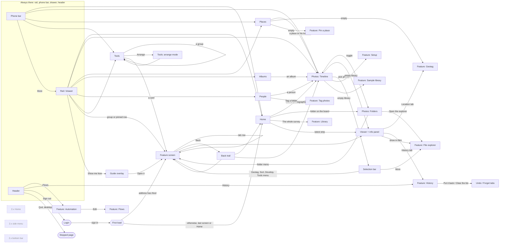

# Photo Manager: screen and tool audit

Audited on 2026-10-11 against `main` at `36e151b`. No code was changed.

**How this was checked.** The tool list comes from the live registry
(`app.registry._TASKS`, 50 tasks) and `core/families.py`. Routes come from
`do_GET` / `do_POST` in `app/server.py`. Callers were found by searching the
page source (`app/web/**`), `app/page.py`, `core/`, `windows/` and `tests/`.
"Never referenced" means a static search found no caller outside the
definition; anything built from a string at run time could hide from that, so
each one below was also read by hand. Three claims were confirmed in a real
browser (headless Chromium against `python -m app.server` with an empty
`PM_DATA`): a new install lands on Home, the 2.x home and side menu are never
displayed, and the phone bar holds Home, Photos, Places, Tools and More.

Line numbers are for that commit. `script.js` means `app/web/page/script.js`;
`NN-name.js` means `app/web/library/js/NN-name.js`; `server.py` means
`app/server.py`; `page.py` means `app/page.py`.

**Ways in that every tool has**, so the table below leaves them out:
`python -m app.cli <name>`, the Tools screen search box (`toolFilter`,
`05-places-albums-tools.js:404`), a pin to the rail if you pin it
(`14-pinned.js`), and any automation flow that uses it. **Way out that every
tool has:** its plan, then Go ahead, then the result, with the run recorded in
History.

## 1. Inventory

### 1a. Screens and overlays

The page is one HTML document. Since 3.0, a "library shell" (`app/web/library/`)
sits in front of the 2.x feature page (`app/web/page/`). `goScreen(name)`
(`01-router.js:109`) switches between seven screens. Everything else is an
overlay or a panel over one of them.

| Screen | File | Purpose | Inbound links | Outbound links |
|---|---|---|---|---|
| **Login** | `app/web/login.html`, served by `server.py:882-883` | The one password, before anything else loads | Any page request while signed out (`_let_in`, `server.py:859-884`); Sign out `script.js:918-924` | Page reload into the app after `POST /api/login` |
| **Home** | `02-home.js:9` | Counts from the index, latest photos, dashboard charts, unfinished-folders board | Rail `01-router.js:35`; phone bar `07-joining.js:27`; default landing `01-router.js:65` | Photos (`02-home.js:43`); Library tool (folder board `09-folders-board.js:54`); Photos Folders view at that folder (`09-folders-board.js:76-82`); viewer (latest strip) |
| **Photos**, Timeline view | `03-photos.js:21` | The grid, newest first, with quick filters and the full filter panel | Rail; phone bar; Home; Places; Albums; People; Back | Viewer; selection bar; Folders view; Setup and Sample library (empty state `03-photos.js:391-392`) |
| **Photos**, Folders view | `15-walk-folders.js:61`, `:90` | Walk the library folder by folder | Photos "Folders" toggle `03-photos.js:34` | Deeper folders; File explorer `15-walk-folders.js:150`; folder menu (`useFolder`, `08-folder-albums.js:9`) |
| **Places** | `05-places-albums-tools.js:13` | Map of located photos, list of named places | Rail; phone bar | Photos filtered by place (`:72`) or "no location" (`:20`); Geotag, Pin a place (empty state `:44-45`) |
| **Albums** | `05-places-albums-tools.js:83` | Computed collections plus kept searches | Rail; phone More (drawer) | Photos showing that album (`:289`) |
| **People** | `08-folder-albums.js:60` | Name tags and the photos carrying them | Rail; phone More (drawer) | Photos filtered by tag (`:131`); Tag photos (`:67`, `:86`) |
| **Tools** | `05-places-albums-tools.js:318` | Every tool as cards, by group; a group page; arrange mode | Rail "All tools" and group rows `01-router.js:180-201`; phone bar | Any tool (`:363`, `:395`); group page (`:374`); arrange mode (`12-tools-arranged.js`) |
| Tools, **arrange mode** | `12-tools-arranged.js` | Regroup, rename and bin tools | Tools screen | Back to Tools |
| **Feature** (one tool open) | `01-router.js:248` then `show()` `script.js:1530` | A tool's form, tab row, plan and result; special editors for 7 tools (`script.js:1623-1628`) | Rail group rows; Tools; pinned rows; selection bar and menus; folder menu; guide; links in the address (`#name`, `01-router.js:63-64`, `script.js:1037-1041`) | Its tabs; other tools named in its plan; viewer; Back |
| **Viewer** + info panel | `script.js:1952` (`peek`), `script.js:2215`; panel `06-viewer.js:12`, `:111` | One photo: stars, colours, tags, details, location, files, history | Photos, Home strip, Search results, File explorer | Geotag `06-viewer.js:167`; History `06-viewer.js:187`; File explorer `script.js:2720`; close |
| **Selection bar** | `04-selection.js:123` | Act on the photos you picked | Picking in Photos | Rate; Geotag, Sort, Send to develop (`:110-115`); Tools menu (`:157`); File explorer (`:262`) |
| **Rail** (desktop) / **drawer** (phone More) | `01-router.js:185`; drawer `script.js:756`, CSS `01-shell.css:311` | The five screens, pinned tools, tool groups, Settings, index status | Always on screen (desktop); More on phone | Every screen; every tool; guide; keys card |
| **Phone bar** | `07-joining.js:31` | Home, Photos, Places, Tools, More | Always on screen under 720 px | Those four screens; drawer |
| **Header** | `app/web/page/index.html:33-51` | Status dot, Flows, History, Refresh, theme, Sign out, Quit | Always on screen | Trouble panel; Automation `script.js:890`; History `script.js:1028`; Appearance popover; Login; stopped page |
| **Back trail** | `10-going-back.js:45` | Returns to the place you left | Header Back button, browser Back, Alt+Left | The previous screen or tool |
| Overlays: **Guide** `script.js:8618`, **Keys** `script.js:3120`, **Appearance** `script.js:287`, **Trouble** `script.js:449`, **Running jobs** `script.js:634`, **Automation news** `script.js:550`, **Folder picker** `script.js:3242` | as listed | Help tour, shortcuts, theme, server health, live jobs, what the loop did, choosing a folder | Rail foot buttons; `?` key; header; any folder box | The tool a guide page names (`page.py:398-530`); close |
| **Stopped** page | `script.js:910-914` | Shown after Quit on a desktop install | Header Quit (desktop only) | None (see D2) |
| 2.x **Home** (legacy) | `script.js:4059` (`drawHome`) | The pre-3.0 phone home screen | None that can fire (see U1) | Features |
| 2.x **side menu** (legacy) | `script.js:783-870`, filled at `script.js:958` | The pre-3.0 feature list with search and "Lately" | Hidden by `02-viewer-panel.css:35` (see U2) | Features |
| 2.x **bottom bar** (legacy) | `script.js:4491-4521` | Home, Library, Explorer, Search, More | Overwritten by the phone bar (see U3) | Features |

### 1b. Tools (features)

50 registered tasks: 48 placed in the rail and Tools screen by
`core/families.py`, plus two (`undo`, `forget`) that open only from History.
Tabs (a task with `parent=`) show in the tab row of their parent feature
and also as their own line under their group in the rail.

| Tool (CLI name) | File | Purpose | Inbound links | Outbound links |
|---|---|---|---|---|
| **File explorer** (`files`) · own editor | `app/tasks/files.py:64` | Browse the folders themselves, with RAWs and previews following along. | rail + Tools ▸ Organize `families.py:35-36`; folder menu `08-folder-albums.js:15`; viewer "show in files" `script.js:2720`; selection More `04-selection.js:262`; Search results `script.js:7387`; Photos folder view `15-walk-folders.js:150`; guide `page.py:477` | tabs: Rename; viewer for a photo |
| **Power rename** (`rename`) · own editor | `app/tasks/rename.py:64` | Every folder in a table, with its name editable in place. | rail + Tools ▸ Organize `families.py:35-36`; tab of **File explorer**; folder menu `08-folder-albums.js:15` | tab row: File explorer |
| **Sort into folders** (`bydate`) | `app/tasks/bydate.py:847` | Break a folder up by date, or by the place it was taken. | rail + Tools ▸ Organize `families.py:35-36`; selection bar `04-selection.js:112`; selection Tools menu `04-selection.js:157`; folder menu `08-folder-albums.js:10`; guide `page.py:488` | tabs: Place names |
| **Import place names** (`import-places`) | `app/tasks/import_places.py:118` | A table of towns, read once, so places work with no internet. | rail + Tools ▸ Organize `families.py:35-36`; tab of **Sort into folders** | tab row: Sort into folders |
| **Separate RAWs** (`unpair`) | `app/tasks/unpair.py:193` | Move the camera's RAW files out of the photo folders into a tree of their own, each one still paired with... | rail + Tools ▸ Organize `families.py:35-36`; selection Tools menu `04-selection.js:157`; folder menu `08-folder-albums.js:10`; guide `page.py:493` | tabs: Re-mirror RAWs |
| **Separate video** (`videos`) | `app/tasks/videos.py:314` | Move clips out of the photo folders into a video tree with the same shape. | rail + Tools ▸ Organize `families.py:35-36`; folder menu `08-folder-albums.js:11` | tabs: Re-mirror video |
| **Re-mirror video** (`remirror_video`) | `app/tasks/remirror_video.py:174` | Move each clip to where the photographs of its moment now live. | rail + Tools ▸ Organize `families.py:35-36`; tab of **Separate video** | tab row: Separate video |
| **Re-mirror RAWs** (`remirror`) | `app/tasks/remirror.py:252` | Make the RAW tree's folders match your photo folders again, after you have reorganised them. | rail + Tools ▸ Organize `families.py:35-36`; tab of **Separate RAWs** | tab row: Separate RAWs |
| **Fix the clock** (`retime`) | `app/tasks/retime.py:267` | Correct the time a camera recorded, for a whole shoot at once. | rail + Tools ▸ Metadata `families.py:39-40`; tab of **Geotag**; selection Tools menu `04-selection.js:158`; folder menu `08-folder-albums.js:12` | tab row: Geotag + 4 sibling tabs |
| **Geotag** (`geotag`) | `app/tasks/geotag.py:269` | Work out where each photograph was taken, from the record of where you were that day. | rail + Tools ▸ Metadata `families.py:39-40`; selection bar `04-selection.js:110`; folder menu `08-folder-albums.js:12`; Places empty state `05-places-albums-tools.js:44`; viewer Location tab `06-viewer.js:167`; guide `page.py:483` | tabs: Import timeline, Pin by hand, Time change, Strip location, Combine & export |
| **Import Google Timeline** (`import-timeline`) | `app/tasks/import_timeline.py:88` | Read your phone's Timeline export into the app, once. | rail + Tools ▸ Metadata `families.py:39-40`; tab of **Geotag** | tab row: Geotag + 4 sibling tabs |
| **Location timeline** (`timeline`) | `app/tasks/timeline.py:277` | Combine your photographs' positions with the imported Timeline, and export both. | rail + Tools ▸ Metadata `families.py:39-40`; tab of **Geotag** | tab row: Geotag + 4 sibling tabs |
| **Pin a place by hand** (`pin`) | `app/tasks/pin.py:125` | Give a whole folder one location, from a map link you pasted. | rail + Tools ▸ Metadata `families.py:39-40`; tab of **Geotag**; Places empty state `05-places-albums-tools.js:45` | tab row: Geotag + 4 sibling tabs |
| **Strip location** (`unlocate`) | `app/tasks/unlocate.py:170` | Take the location off a folder of photographs. | rail + Tools ▸ Metadata `families.py:39-40`; tab of **Geotag** | tab row: Geotag + 4 sibling tabs |
| **Rating & tags** (`ratings`) | `app/tasks/ratings.py:396` | Carry stars and colours back onto the originals and their RAWs. | rail + Tools ▸ Metadata `families.py:39-40` | tabs: Apply label, Tag photos |
| **Apply label** (`label`) | `app/tasks/label.py:262` | Mark a whole folder you have already made your mind up about. | rail + Tools ▸ Metadata `families.py:39-40`; tab of **Rating & tags**; selection Tools menu `04-selection.js:158` | tab row: Rating & tags + 1 sibling tab |
| **Tag photos** (`tags`) | `app/tasks/tags.py:314` | Put tags on a whole folder, or on whatever matches a rule. | rail + Tools ▸ Metadata `families.py:39-40`; tab of **Rating & tags**; selection Tools menu `04-selection.js:157`; folder menu `08-folder-albums.js:13`; People screen `08-folder-albums.js:67`, `:86` | tab row: Rating & tags + 1 sibling tab |
| **Library** (`library`) · look only | `app/tasks/library.py:399` | Every folder, and how much of the work on it is finished. | rail + Tools ▸ Review `families.py:43-44`; Home folder board `09-folders-board.js:54`; guide `page.py:459` | tabs: Space, Clean-up status, Search, Compare; its dashboard arrangement feeds Home `02-home.js:47` |
| **Search** (`search`) · look only | `app/tasks/search.py:171` | Find photographs by camera, lens, exposure, stars, tags or location. | rail + Tools ▸ Review `families.py:43-44`; tab of **Library**; `searchFor()` `script.js:6612`; guide `page.py:471` | tab row: Library + 3 sibling tabs; viewer; File explorer `script.js:7387` |
| **Compare** (`compare`) · look only | `app/tasks/compare.py:121` | Two things about the library at once, as a grid. | rail + Tools ▸ Review `families.py:43-44`; tab of **Library** | tab row: Library + 3 sibling tabs |
| **Thin brackets** (`thin`) | `app/tasks/thin.py:263` | Keep one frame of each bracket set and put the spares aside. | rail + Tools ▸ Review `families.py:43-44`; tab of **Clean up** | tab row: Clean up + 6 sibling tabs |
| **Find brackets** (`brackets`) | `app/tasks/brackets.py:180` | How the bracket settings group a folder, and a tag for each set. | rail + Tools ▸ Review `families.py:43-44`; tab of **Clean up** | tab row: Clean up + 6 sibling tabs |
| **Cull by rating** (`cull`) | `app/tasks/cull.py:275` | Put the low-rated photographs aside - into a folder you can empty later, not deleted. | rail + Tools ▸ Review `families.py:43-44`; tab of **Clean up**; selection Tools menu `04-selection.js:157`; folder menu `08-folder-albums.js:13` | tab row: Clean up + 6 sibling tabs |
| **Find blurry** (`blur`) | `app/tasks/blur.py:258` | Measure how sharp each photo is, and act on the blurry ones. | rail + Tools ▸ Review `families.py:43-44`; tab of **Clean up** | tab row: Clean up + 6 sibling tabs |
| **Check exposure** (`exposure`) | `app/tasks/exposure.py:147` | Find the blown-out and the too-dark, with the numbers that say so. | rail + Tools ▸ Review `families.py:43-44`; tab of **Clean up**; folder menu `08-folder-albums.js:14` | tab row: Clean up + 6 sibling tabs |
| **Find duplicates** (`duplicates`) | `app/tasks/duplicates.py:312` | The same photograph twice: identical copies for certain, re-saved ones if you ask. | rail + Tools ▸ Review `families.py:43-44`; tab of **Clean up**; selection Tools menu `04-selection.js:157`; folder menu `08-folder-albums.js:14` | tab row: Clean up + 6 sibling tabs |
| **Make previews** (`previews`) | `app/tasks/previews.py:413` | Small copies of your photographs, for rating on a tablet away from the NAS. | rail + Tools ▸ Develop `families.py:47`; selection Tools menu `04-selection.js:157`; folder menu `08-folder-albums.js:11`; guide `page.py:498` | tabs: Re-mirror previews |
| **Re-mirror previews** (`remirror_previews`) | `app/tasks/remirror_previews.py:174` | Move each preview to where its photograph now lives. | rail + Tools ▸ Develop `families.py:47`; tab of **Make previews** | tab row: Make previews |
| **Send to develop** (`develop`) | `app/tasks/develop.py:478` | Copy the shots worth developing out, and take the finished ones back. | rail + Tools ▸ Develop `families.py:47`; selection bar `04-selection.js:115`; guide `page.py:509` | tabs: File developed |
| **File developed** (`filed`) | `app/tasks/filed.py:286` | Match Lightroom's exports to their originals, and file them. | rail + Tools ▸ Develop `families.py:47`; tab of **Send to develop** | tab row: Send to develop |
| **Storage** (`space`) · look only | `app/tasks/space.py:222` | Where the disk has gone, folder by folder - and what could be freed. | rail + Tools ▸ Maintain `families.py:50`; tab of **Library**; guide `page.py:465` | tab row: Library + 3 sibling tabs |
| **What can be cleaned up** (`tidy`) · look only | `app/tasks/tidy.py:153` | What is sitting in piles you have already decided against. | rail + Tools ▸ Maintain `families.py:50`; tab of **Library** | tab row: Library + 3 sibling tabs |
| **Delete folder** (`delfolder`) | `app/tasks/delfolder.py:160` | Delete folders, with their RAWs and previews, to the Recycle Bin. | rail + Tools ▸ Maintain `families.py:50`; tab of **Clean up** | tab row: Clean up + 6 sibling tabs |
| **Clean up** (`cleanup`) | `app/tasks/cleanup.py:308` | Empty the piles once you no longer want what is in them. | rail + Tools ▸ Maintain `families.py:50`; guide `page.py:516` | tabs: Cull by rating, Find blurry, Delete folder, Find duplicates, Check brackets, Thin brackets, Check exposure |
| **History** (`history`) · hidden from rail, look only | `app/tasks/history.py:237` | Every run that wrote something, numbered, with what it did. | rail + Tools ▸ Maintain `families.py:50`; header button `script.js:1028`; viewer History tab `06-viewer.js:187` | tabs: Put it back, Clear the list; plan buttons to Put a run back and Clear the list `history.py:191-212` |
| **Automation** (`automation`) | `app/tasks/automation.py:463` | Run a flow: some features, in an order, each when the thing it watches changes. | rail + Tools ▸ Automation `families.py:58`; header Flows button `script.js:890`; run a flow `script.js:7747`; waiting step `script.js:4191`; guide `page.py:522` | tabs: Runs, Flows; Flows "Edit" `script.js:4290`; Runs tab |
| **Automation runs** (`autoruns`) · look only | `app/tasks/autoruns.py:170` | What the background loop has actually done, and what each pass took off the NAS. | rail + Tools ▸ Automation `families.py:58`; tab of **Automation**; running badge `script.js:568` | tab row: Automation + 1 sibling tab |
| **Flows** (`flows`) · own editor | `app/tasks/flows.py:293` | Build a flow: steps, each a feature with its own settings, in order. | rail + Tools ▸ Automation `families.py:58`; tab of **Automation**; Automation summary "Edit" `script.js:4290` | tab row: Automation + 1 sibling tab |
| **Setup** (`setup`) · Save, no plan, look only | `app/tasks/setup.py:202` | The three trees, and what counts as a bracket. Set once, read everywhere. | rail + Tools ▸ Settings `families.py:69-70`; Photos empty state `03-photos.js:391`; guide `page.py:446`, `:529` | tabs: Reindex, Colour meanings, Permissions, Password, Chart bands, Backup, Checklist, Camera names, Sample library |
| **Reindex** (`reindex`) | `app/tasks/reindex.py:219` | Tell the NAS's own apps - Photos, File Station - that these folders changed. | rail + Tools ▸ Settings `families.py:69-70`; tab of **Setup** | tab row: Setup + 8 sibling tabs; shares one "NAS" tab with Permissions `script.js:188` |
| **Colour meanings** (`labels`) · Save, no plan, look only | `app/tasks/labels.py:147` | What each colour means, what it writes, and where it sends. | rail + Tools ▸ Settings `families.py:69-70`; tab of **Setup** | tab row: Setup + 8 sibling tabs |
| **Camera names** (`cameras`) · own editor | `app/tasks/cameras.py:100` | What each camera is called, against the code it writes into the file. Phones write order codes; this is... | rail + Tools ▸ Settings `families.py:69-70`; tab of **Setup** | tab row: Setup + 8 sibling tabs |
| **Password** (`password`) | `app/tasks/password.py:150` | Lock the app behind one password. | rail + Tools ▸ Settings `families.py:69-70`; tab of **Setup** | tab row: Setup + 8 sibling tabs |
| **Chart bands** (`bands`) · own editor | `app/tasks/bands.py:71` | Where the brackets fall on a chart: which apertures are one bar. | rail + Tools ▸ Settings `families.py:69-70`; tab of **Setup** | tab row: Setup + 8 sibling tabs |
| **Permissions check** (`permissions`) | `app/tasks/permissions.py:335` | Check what the NAS lets this app touch, and fix what it does not. | rail + Tools ▸ Settings `families.py:69-70`; tab of **Setup** | tab row: Setup + 8 sibling tabs; shares one "NAS" tab with Reindex `script.js:188` |
| **Backup** (`backup`) | `app/tasks/backup.py:220` | The app's own state, kept - and a backup put back. | rail + Tools ▸ Settings `families.py:69-70`; tab of **Setup** | tab row: Setup + 8 sibling tabs |
| **Checklist** (`checklist`) · look only | `app/tasks/checklist.py:145` | Is everything set up? Each line measured, with where to fix it. | rail + Tools ▸ Settings `families.py:69-70`; tab of **Setup**; fresh-install landing `script.js:1050` (overridden, see U4) | tab row: Setup + 8 sibling tabs; text only: each row names where to fix it, no link `checklist.py:123` |
| **Sample library** (`demo`) | `app/tasks/demo.py:190` | A small library with real EXIF, to practise every feature on. | rail + Tools ▸ Settings `families.py:69-70`; tab of **Setup**; Photos empty state `03-photos.js:392`; guide `page.py:419` | tab row: Setup + 8 sibling tabs |
| **Put a run back** (`undo`) · hidden from rail | `app/tasks/undo.py:158` | Reverse a run that moved files, after reading what it would move. | tab of **History**; History plan buttons `history.py:191`, `:209` (only way in) | tab row: History + 1 sibling tab |
| **Clear the history** (`forget`) · hidden from rail | `app/tasks/forget.py:148` | Empty the list of runs - all of it, or anything past a given age. | tab of **History**; History plan button `history.py:212` (only way in) | tab row: History + 1 sibling tab |

### 1c. Server routes

All in `app/server.py`: 61 API routes (38 read, 23 write) and 8 page and asset
routes. "Called from" is the page code that requests it;
"Uses" is what the route reads or writes.

**Pages and assets**

| Route | Line | Purpose | Called from | Uses |
|---|---|---|---|---|
| `GET /`, `/index.html` | 971 | The whole app as one page | Browser | `app/page.py` `PAGE` |
| `GET /favicon.ico`, `/icon-32.png` | 945, 973 | Tab icon, open before login | Browser, `login.html` | `app/icons.py` |
| `GET /icon-192.png`, `/icon-512.png` | 975, 977 | Install icons | Manifest, `sw.js` | `app/icons.py` |
| `GET /manifest.webmanifest` | 979 | Install as an app | Browser | `MANIFEST` |
| `GET /sw.js` | 981 | Service worker | `script.js` registration | `app/web/page/sw.js` |
| Login page (any page route while signed out) | 882 | Password gate | Browser | `app/loginpage.py` |

**API, read (`GET`)**

| Route | Line | Purpose | Called from | Uses |
|---|---|---|---|---|
| `/api/gate` | 947 | Is there a password, am I in (open) | Nothing in the page; `tests/test_access.py:295` only | `core/access.py` |
| `/api/client` | 952 | What this server is, for other clients (open) | Nothing in the page; `tests/test_clients.py:185`; `docs/DESIGN.md:765` | `core/identity.py` |
| `/api/health` | 989 | Server health for the status dot | `script.js:723` | `health()` |
| `/api/jobs` | 991 | Everything running | `script.js:637` | `JOBS` |
| `/api/tasks` | 1003 | Every task and its options | `script.js:936`, `:3366`; `12-tools-arranged.js:355` | `registry.describe_all`, `core/families.py` |
| `/api/index` | 1055 | Index progress | `01-router.js:79` | `core/catalogue.py` |
| `/api/overview` | 1058 | Library totals | **Nothing** (see N1) | `core/browse.overview` |
| `/api/timeline` | 1062 | Photos, a page at a time, with filters | `02-home.js:68`; `03-photos.js:262`, `:505`; `05-places-albums-tools.js:236` | `core/browse.py`, `core/find.py` |
| `/api/places` | 1078 | Map clusters and place names | `05-places-albums-tools.js:29` | `core/browse.clusters` |
| `/api/dashboard` | 1086 | Home numbers and charts | `02-home.js:15` | `core/browse.dashboard` |
| `/api/hidden` | 1092 | Folders left out of Photos | `11-left-out.js:24` | `core/browse.py` |
| `/api/pinned` | 1095 | Pinned tools | `14-pinned.js:28` | `core/families.pinned` |
| `/api/toolgroups` | 1098 | Your tool arrangement | `12-tools-arranged.js:29`, `:374` | `core/families.arranged` |
| `/api/inside` | 1109 | One folder from the index | `15-walk-folders.js:34` | `core/browse.py` |
| `/api/choices` | 1127 | Filter menu values | `03-photos.js:114` | `core/browse.py` |
| `/api/folders` | 1133 | Home folder board | `09-folders-board.js:26` | `core/browse.py` |
| `/api/people` | 1143 | Name tags | `08-folder-albums.js:73` | `core/browse.people` |
| `/api/albums` | 1147 | Albums and put-away albums | `05-places-albums-tools.js:98` | `core/browse.albums` |
| `/api/item` | 1163 | One photo from the index | `06-viewer.js:84` | `core/browse.py` |
| `/api/exists` | 1169 | Do these folders exist | `script.js:8341` | `os.path` |
| `/api/files` | 1173 | List a folder (file explorer) | `script.js:4612`, `:4671`, `:5506` | `core/filesops.py` |
| `/api/folder-status` | 1190 | What has been done to a folder | `script.js:5153` | `core/filesops.py` |
| `/api/photo-marks` | 1199 | Stars and colours in a folder | `script.js:4721` | `core/filesops.py` |
| `/api/searches` | 1210 | Kept searches | `script.js:7287`; `05-places-albums-tools.js:277` | `core/find.saved` |
| `/api/values` | 1214 | Values the library holds | `script.js:7247` | `core/stats.py` |
| `/api/rename-list` | 1229 | Folder table for Power rename | `script.js:6043` | `core/renames.py` |
| `/api/folder-size` | 1249 | Folder size | `script.js:4760` | `core/filesops.py` |
| `/api/files/progress` | 1258 | Copy or move progress | `script.js:5854` | `FILE_JOBS` |
| `/api/download` | 1265 | Download a file | `script.js:2616`, `:5971` | `_download` |
| `/api/pattern` | 1268 | Check a naming pattern | `script.js:1095` | `core/naming.py` |
| `/api/photo` | 1275 | One photo's marks for the viewer | `script.js:2281` | `core/quickedit.py` |
| `/api/photo-about` | 1294 | Shot details | `script.js:2662`, `:5641` | `core/quickedit.py` |
| `/api/thumb` | 1303 | Thumbnail | `script.js:1898`; `sw.js:29` | `_thumb()` |
| `/api/file` | 1306 | The file itself | `script.js:2148`, `:2614` | `_one_file` |
| `/api/video` | 1309 | Stream a clip | `script.js:2232` | `_video` |
| `/api/flows` | 1312 | Flows and their state | `script.js:4001`, `:4051`, `:4254`, `:7430` | `app/tasks/flows.py` |
| `/api/browse` | 1319 | Folder picker | `script.js:3245` | `os.scandir` |
| `/api/progress` | 1329 | A run's progress | `script.js:3457`, `:8279` | `JOBS` |

**API, write (`POST`)**

| Route | Line | Purpose | Called from | Uses |
|---|---|---|---|---|
| `/api/login` | 1340 | Sign in | `login.html:62` | `core/access.py` |
| `/api/logout` | 1342 | Sign out | `script.js:921` | `core/access.py` |
| `/api/plan` | 1507 | Plan a task (writes nothing) | `script.js:3425` | `registry`, the task's `plan()` |
| `/api/apply` | 1346 | Run a plan | `script.js:8267` | the task's `apply()` |
| `/api/cancel` | 1348 | Stop a run | `script.js:3434`, `:8251` | `JOBS` |
| `/api/quit` | 1350 | Stop the desktop app | `script.js:908` | desktop only |
| `/api/people` | 1364 | Name a tag as a person | `08-folder-albums.js:124` | `core/browse.py` |
| `/api/index` | 1376 | Refresh the index | `01-router.js:233` | `core/catalogue.py` |
| `/api/save` | 1381 | Save a settings tab | `script.js:3345` | `_save()` |
| `/api/flows` | 1383 | Edit flows | `script.js:7448` | `app/tasks/flows.py` |
| `/api/photo` | 1385 | Write stars, colour, tags, delete | `script.js:2744`, `:2814`; `04-selection.js:199` | `core/quickedit.py` |
| `/api/files` | 1387 | Copy, move, rename, delete files | `script.js:5840`, `:5867`, `:5882`, `:6001` | `core/filesops.py` |
| `/api/rename` | 1389 | Rename many folders | `script.js:6241` | `core/renames.py` |
| `/api/boards` | 1391 | Arrange the dashboard | `script.js:6699`, `:7146` | `core/boards.py` |
| `/api/bands` | 1420 | Chart bands | `script.js:7090` | `core/bands.py` |
| `/api/cameras` | 1435 | Camera names | `script.js:7175` | `core/devices.py` |
| `/api/albums` | 1448 | Put albums away | `05-places-albums-tools.js:158` | `core/browse.py` |
| `/api/pinned` | 1452 | Pin tools | `14-pinned.js:28` | `core/families.pin` |
| `/api/toolgroups` | 1456 | Save or reset your arrangement | `12-tools-arranged.js:332`, `:342` | `core/families.py` |
| `/api/hidden` | 1465 | Leave folders out of Photos | `11-left-out.js:24` | `core/browse.py` |
| `/api/searches` | 1476 | Keep or forget a search | `script.js:7368`; `05-places-albums-tools.js:252`, `:267`; `08-folder-albums.js:37` | `core/find.py` |
| `/api/files-of` | 1491 | Files behind a set of photos | `script.js:7396` | `_files_of` |
| `/api/patterns` | 1493 | Keep a naming pattern | `script.js:1105` | `core/naming.py` |

## 2. Screen navigation

The rail (desktop), phone bar and drawer are on every screen, so every screen
can reach Home, Photos, Places, Albums, People, Tools and any tool in one or
two presses. The chart draws those once, as the "Always there" box, and then
only the links that live inside a screen. Dashed boxes are legacy 2.x screens
that are in the page but never shown.

## 3. Flags and recommendations

Each flag has an ID used in the summary table at the end.

### Unreachable screens

**U1. 2.x Home screen: delete.**
`drawHome` (`script.js:4059`) draws into `#home`, which the shell hides with
`body.shell #home{display:none}` (`01-shell.css:37`). Every way to switch it on
is gone: the header switch `#viewswap` (`script.js:1036`) is hidden by the same
CSS rule; the 2.x bottom bar's Home (`script.js:4518`) is overwritten (U3);
`goHome` (`script.js:4043`) has no caller; and `boot()`'s `wantsHome()`
(`script.js:1052`) is undone by `shellStart` calling `setHome(false, false)`
(`01-router.js:57`). The browser check confirmed `#home` stays hidden on phone
and desktop. The comment at `01-router.js:52-56` keeps it as a fallback "if
this never runs", but the shell script is shipped in the same page
(`page.py:166`), so that fallback only helps if the library script throws at
load. Remove `drawHome`, `goHome`, `wantsHome`, the home half of `setHome`,
`loadSummaryData` if nothing else needs it, `#viewswap` and `#home` in
`index.html:42,57`, and the `pm_home` setting. Tests that pin the old layer
need updating in the same change: `tests/test_consistency.py:110-117` and
`tests/test_page_behaviour.py:185`, `:793`.

**U2. 2.x side menu (`#nav`): delete, with U1.**
`navRow`, `findWords`, `navFilter`, `recentList`, `pushRecent`, `drawRecent`
(`script.js:783-870`) and the fill at `script.js:958` draw into `main > nav#nav`,
hidden by `02-viewer-panel.css:35`. The rail (`01-router.js:185`) and the Tools
search (`05-places-albums-tools.js:404`) replaced it. The "Lately" list
(`drawRecent`, `script.js:859`) is the one thing with no replacement; if it is
wanted, move it into the rail rather than keep the hidden menu.

**U3. 2.x bottom bar: delete, with U1.**
`BOTTOM` and `drawBottom` (`script.js:4491-4521`) write into `#bottom`, which
`drawShellBottom` (`07-joining.js:31`) overwrites on every rail draw
(`07-joining.js:40-41`). The two lists disagree (Library, Explorer, Search
against Photos, Places, Tools). `tests/test_consistency.py:110-112` asserts the
old list, so it changes in the same PR.

**U4. Checklist as the new-install landing page: keep the checklist, fix the
landing.** `boot()` opens Checklist when there is no library
(`script.js:1049-1051`), and the Checklist's own docstring says it is "the first
thing a new install opens" (`app/tasks/checklist.py:5`). Then `shellStart` goes
to Home anyway (`01-router.js:63-65`). The browser check on an empty `PM_DATA`
found `SCREEN = "home"` with Checklist loaded behind it, unseen. Recommend that
`shellStart` honour the same "no library" test and open Checklist, so the
documented first run is the real one.

**U5. NAS-only tools on Windows: keep, hide off-NAS.**
Reindex and Permissions are folded into one "NAS" tab (`script.js:188-190`) and
labelled "Only on a Synology NAS" (`05-places-albums-tools.js:392`), but they
are listed on every machine. `CLAUDE.md` (Running fully on Windows table) already
plans to hide them. Hide them when the server reports a desktop or Windows
install; keep the code for the NAS.

**U6. Put a run back and Clear the history: keep.** They have no group in
`core/families.py` and open only from History's plan buttons
(`app/tasks/history.py:191`, `:209-212`). That is deliberate (`inline=True`,
and the reason is written at `app/registry.py` above `acts`). Listed so nobody
"fixes" it.

### Dead ends

**D1. Home on an empty library: keep, add a way forward.** Home's only buttons
are Refresh and See all photographs (`02-home.js:33`, `:43`). The rail foot
says "Set one in Setup" as plain text, not a link (`01-router.js:223`). Photos
does offer Open Setup and Build a sample library (`03-photos.js:391-392`), so a
new user is two presses from the fix and is not told. Give Home the same two
buttons when nothing is indexed. (U4 would also cover the first run.)

**D2. Stopped page after Quit: keep.** `script.js:910-914` replaces the page
with a message and no link. The server has stopped, so there is nowhere to go;
the message already says to start it from the Start menu.

**D3. Login with a forgotten password: keep, add one line.** The login page
(`app/web/login.html:40-52`) has no way forward if the password is lost, and no
doc in the repo says how to recover (searched for "forgot"/"lost"). The password
lives in `access.json` under `PM_DATA` (`core/access.py:49`, `:61`), and
`PM_PASSWORD` can set it from the environment. Add a sentence to the login page
and to `nas/README.md` / `windows/README.md` saying so.

### Overlapping screens and tools

**O1. Tabs filed under a different group from their parent: merge the
hierarchy.** Cull, Blur, Duplicates, Brackets, Thin and Exposure are in Review
(`core/families.py:43-44`) but are tabs of Clean up, which is in Maintain
(`parent="cleanup"` at `cull.py:289`, `blur.py:269`, `duplicates.py:325`,
`brackets.py:195`, `thin.py:278`, `exposure.py:154`). The reverse happens with
Storage and Clean-up status: Maintain (`families.py:50`) but tabs of Library in
Review (`space.py:230`, `tidy.py:161`). So opening Cull from Review shows a
tab row headed by a Maintain tool, mixing seven tools from two groups. Make
`parent` follow the family: give Review's weeding tools a Review parent (Cull
is the natural one) and move Storage and Clean-up status under Clean up.

**O2. Three hand-written "tools for these photos" lists: merge into one.**
The selection bar (`04-selection.js:107-120`), its Tools menu
(`04-selection.js:157-158`) and the folder menu (`08-folder-albums.js:9-15`)
each list tools by hand, and they disagree: the folder menu has Geotag, Fix the
clock, Check exposure, Power rename and File explorer; the Tools menu has Apply
label and not Geotag; Sort into folders is in both the bar and its menu. Build
all three from one list, ideally the tasks that take a `Folder` option.

**O3. Search (tool) and the Photos filter panel: merge the screens, keep the
task.** Both build the same `core/find.Ask` (Photos fields at
`03-photos.js:93-110`; `app/tasks/search.py:28-30`) and share the same kept
searches (`/api/searches`, which also feed Albums, `core/browse.py:1072-1085`).
Make the Search entry open Photos with the filter panel, and keep the `search`
task for the command line and flows.

**O4. Delete folder and the File explorer's delete: merge.** The explorer
deletes with RAWs and previews (`core/filesops.py:353`, `with_raw`,
`with_previews`) but not video; Delete folder also takes the video and shows a
plan first (`app/tasks/delfolder.py:1-15`). Two rules for one act. Have the
explorer's Delete on a folder hand off to Delete folder's plan, the way the
selection bar hands off with `pickInto` (`04-selection.js:226`).

**O5. Library (tool) and Home's folder board: keep both.** The board says
outright it is the index-backed part of Library's survey
(`09-folders-board.js:1-13`, route comment `server.py:1133-1136`). Library also
reads the preview and RAW trees, which the index does not. Different sources,
so keep; the board already links to it (`09-folders-board.js:54`).

**O6. Clean-up status, Clean up and Storage: keep.** Clean-up status looks,
Clean up empties, and the split is a stated design choice
(`app/tasks/tidy.py:10-14`). Storage is about disk use as a whole. Fix only the
filing (O1).

**O7. Re-mirror RAWs, previews and video: keep.** Same shape, different
matching: by name (`remirror.py:27`, `pair_trees`), by name or capture time
(`remirror_previews.py:30-33`), by shoot time (`remirror_video.py:30-31`).
Merging them would join three matching rules behind one switch.

**O8. History and Automation runs: keep, link each to the other.** History is
every run that wrote (`app/tasks/history.py`); Runs is every background pass,
including ones that changed nothing (`app/tasks/autoruns.py`). Related but not
the same list.

**O9. Apply label (`label`) and Colour meanings (`labels`): keep, retitle.**
Different jobs (`label.py:262`, `labels.py:147`), but CLI names one letter
apart. Renaming a CLI name would break saved flows, so change only the titles
if it causes confusion.

**O10. `/api/gate` and `/api/client`: keep for now, then merge.** Both are open
before login and say whether a password is on (`server.py:947-968`). The page
uses neither; `client` is the documented contract for other clients
(`docs/DESIGN.md:765`), `gate` is used only by `tests/test_access.py:295`.
Check the client contract (kept outside this repo) for `gate`; if nothing uses
it, fold its `fixed` field into `/api/client` and delete `gate`.

**O11. Two library scripts numbered 13: keep, rename one.**
`13-guide-in-rail.js` and `13-viewer-panel-sync.js` both use 13, so their
order rests on the rest of the name. `CLAUDE.md` says new pieces take the next
number. Rename `13-viewer-panel-sync.js` to `16-viewer-panel-sync.js`. It only
wraps `viewerShow` (defined in `script.js:2215`), so loading later is safe.

### Components and handlers never referenced

**N1. `GET /api/overview`: delete.** No caller anywhere, tests included
(`server.py:1058-1061`). `/api/dashboard` already carries the overview
(`core/browse.py:651`). Keep `browse.overview()`, which dashboard uses. Fix the
comment that still names the route (`01-router.js:7`).

**N2. Page functions with no caller: delete.**

| Function | Where | Note |
|---|---|---|
| `goHome` | `script.js:4043` | Part of U1 |
| `fmView` | `script.js:5660` | Grid/list toggle in the file explorer; no button calls it |
| `mapLatLon` | `script.js:8455` | Inverse of `mapPx`; never used |
| `jumpTo` | `01-router.js:241` | |
| `settingsTasks` | `05-places-albums-tools.js:399` | `SETFAM.tasks` (`05-places-albums-tools.js:304-307`) reads `SETTINGS_TASKS` directly |
| `arrShow` | `12-tools-arranged.js:187` | Its siblings `arrPut` and `arrHide` are used by `tests/test_page_behaviour.py`, so keep those |
| `editor === "boards"` branch | `script.js:1682` | No task or plan sets `editor = "boards"` (checked `app/tasks/*.py`) |

`fmView` may be a lost button rather than dead code. If the explorer is meant
to have a grid/list switch, wire it up instead of deleting it.

**N3. Icon never drawn: delete.** `i-heart` in
`app/web/library/icons/01-library.svg:21`. None of the other 62 icons is unused.

**N4. Python functions with no caller, tests included: delete.**

| Function | Where |
|---|---|
| `defaults_for` | `app/tasks/setup.py:56` |
| `_saved` | `app/tasks/setup.py:198` |
| `_targets` | `app/tasks/ratings.py:50` |
| `tidy_if_long` | `core/acl.py:265` |
| `tails` | `core/renames.py:442` |
| `_atom` | `core/demo.py:260` |
| `place_of` | `core/places.py:477` |
| `start_page` | `core/desktop.py:394` |
| `_entry_for` | `core/catalogue.py:495` |

Functions called only from tests (for example `registry.in_sidebar`,
`registry.py:1128`, and `bydate.week_start`, `bydate.py:138`) are left alone:
the tests are the spec.

## Summary

| ID | Item | Kind | Call |
|---|---|---|---|
| U1 | 2.x Home | unreachable | delete |
| U2 | 2.x side menu | unreachable | delete |
| U3 | 2.x bottom bar | unreachable | delete |
| U4 | Checklist as first-run page | unreachable | keep, fix landing |
| U5 | Reindex, Permissions on Windows | reachable where useless | keep, hide off-NAS |
| U6 | Put a run back, Clear the history | History only | keep |
| D1 | Home, empty library | dead end | keep, add Setup link |
| D2 | Stopped page | dead end (intended) | keep |
| D3 | Login, lost password | dead end | keep, add a line |
| O1 | Tabs filed under another group | overlap | merge hierarchy |
| O2 | Three "tools for these" lists | overlap | merge |
| O3 | Search and Photos filters | overlap | merge screens |
| O4 | Delete folder and explorer delete | overlap | merge |
| O5 | Library and Home folder board | overlap | keep |
| O6 | Clean-up status, Clean up, Storage | overlap | keep |
| O7 | Three re-mirror tools | overlap | keep |
| O8 | History and Runs | overlap | keep |
| O9 | `label` and `labels` | naming | keep |
| O10 | `/api/gate` and `/api/client` | overlap | keep, then merge |
| O11 | Two `13-*.js` files | naming | keep, rename |
| N1 | `/api/overview` | unused | delete |
| N2 | 6 page functions and 1 branch | unused | delete |
| N3 | `i-heart` icon | unused | delete |
| N4 | 9 Python functions | unused | delete |

Suggested order: N1 to N4 first (no behaviour change, smallest risk), then U1 to
U3 as one UI PR with its test updates, then U4 and D1, then the merges.
